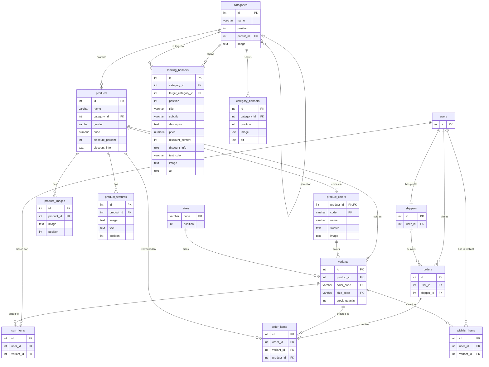

# Ecom-OMS – Entity Relationship Diagram

Conceptual ERD of the Ecom-OMS PostgreSQL database: 15 tables with their primary keys, foreign keys and relationships. Regular columns are added as each group of tables is designed.

- **Catalog**: categories (self-referencing tree), products, their colors, detail images and features, the shared size lookup, and variants (one row per product × color × size, the unit that is stocked and sold).
- **Banners**: landing banners and category banners, both attached to categories.
- **Users and orders**: user accounts (customer, admin, shipper roles), shipper profiles, cart and wishlist items, orders and order items (order items snapshot product data at the time of purchase).

